# Super Dolores (SuperApp TDD)

**Autor:** Aguilar Ortiz Gael Alejandro  
**Grupo:** GTID241  
**Materia:** Aplicaciones Móviles  

---

## Ronda 1. Preparar el proyecto

### Crear el proyecto
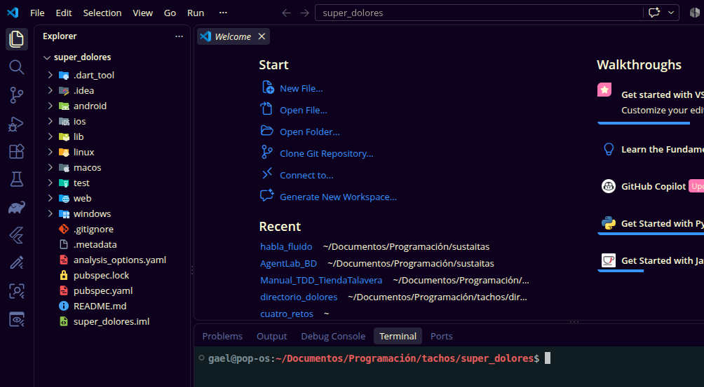

### Estructura y pubspec.yaml
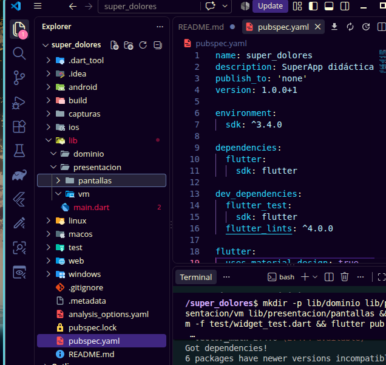

## Ronda 2. Dinero, fechas y errores

### Fase ROJO (Pruebas fallando)
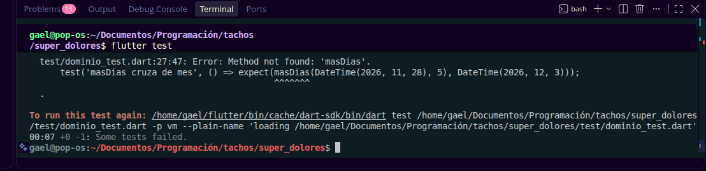

### Fase VERDE (Pruebas pasando)
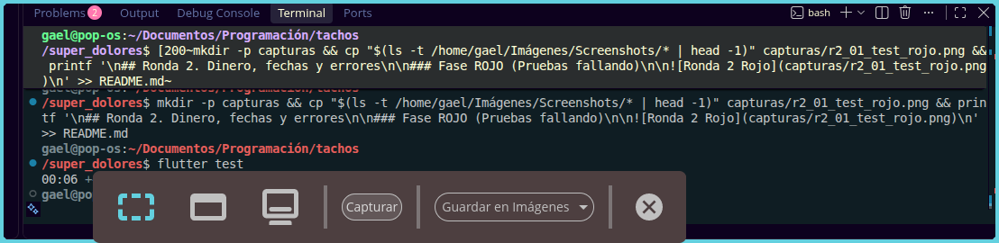

## Ronda 3. El monedero

### Fase ROJO (Pruebas del monedero)
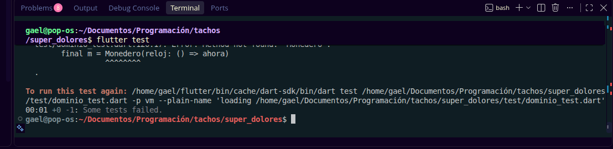

### Fase VERDE (Monedero funcionando)
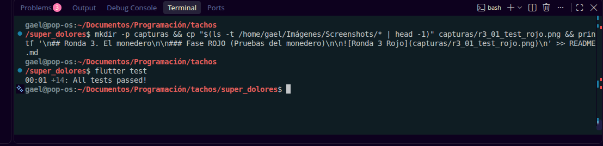

## Ronda 4. Eventos: el sistema nervioso

### Fase ROJO (Pruebas del bus de eventos)
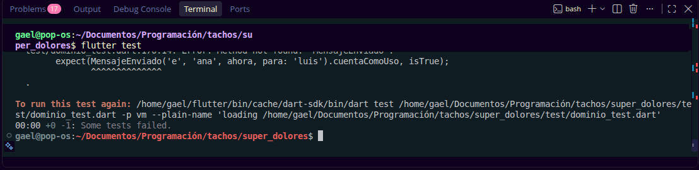

### Fase VERDE (Bus de eventos funcionando)
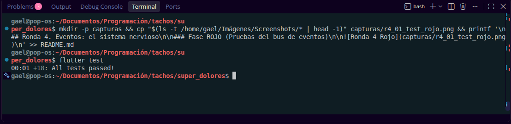

## Rondas 5 a 11. Servicios, Mini-apps, Plataforma y Retención

### Fase ROJO (Pruebas de servicios y permisos)
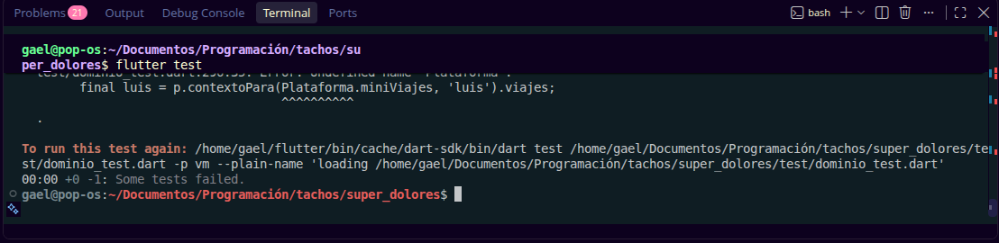

### Fase VERDE (Todo el dominio y retención funcionando)
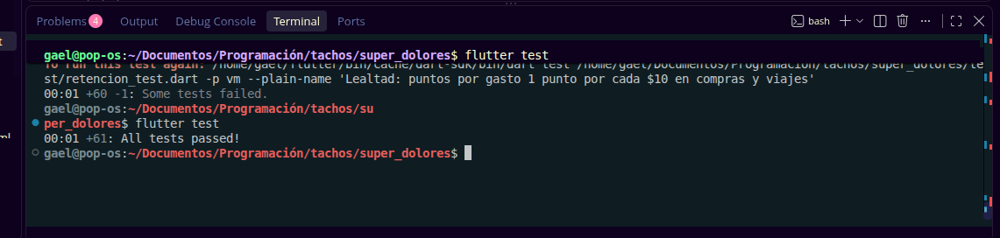

## Ronda 12. ViewModels

### Fase ROJO (Pruebas de ViewModels)
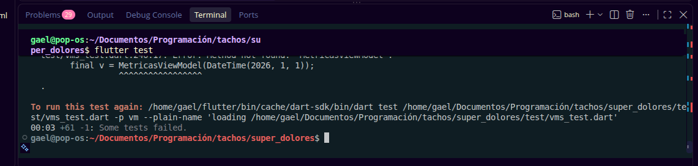

### Fase VERDE (Todos los ViewModels y 4 suites de pruebas pasando)
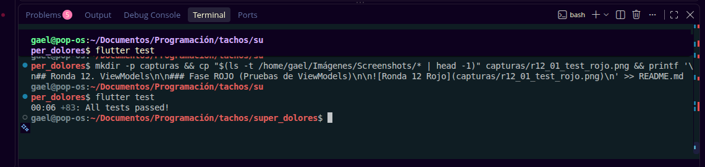

## Ronda 13. Las pantallas y la concha de la SuperApp

### Envío de dinero en el chat
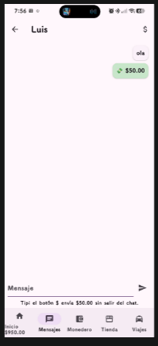

### Compra en comercio local
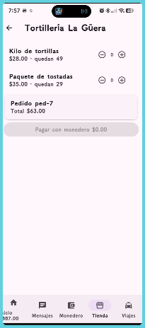

### Viaje finalizado
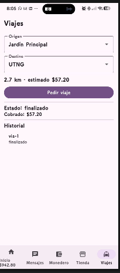

### Principio de menor privilegio (Horóscopo)
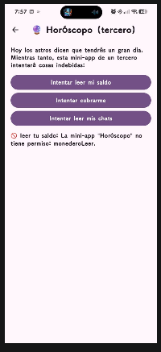

### Tablero de retención (DAU, WAU, MAU y Stickiness)
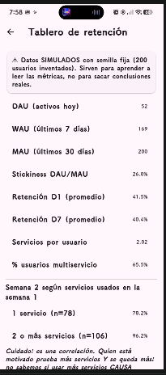

---

## Cierre: Lista de verificación y preguntas

### Lista de verificación
- [x] `flutter test` pasa en verde (cuatro archivos de pruebas).
- [x] Mandar dinero en el chat cambia ambos saldos, deja un mensaje y avisa al destinatario.
- [x] Una compra reparte comisión y la suma total del dinero no cambia.
- [x] Un viaje recorre sus estados y los saltos ilegales fallan sin tocar dinero.
- [x] El horóscopo (tercero) no puede leer el saldo ni los chats.
- [x] Apagar Viajes lo quita de la barra y bloquea sus llamadas.
- [x] El tablero muestra DAU, WAU, MAU, stickiness y retención con la advertencia de datos sintéticos.

### Preguntas de discusión

1. **¿Por qué el saldo es la suma de los movimientos y no un número que se edita?**  
   Porque evita desincronizaciones ante fallos o dobles toques y deja un historial completo de auditoría de cada entrada y salida.

2. **Explica con tus palabras qué problema resuelve la idempotencia y da un ejemplo real.**  
   Evita que una misma operación se cobre o ejecute dos veces si se reintenta por un fallo de conexión o doble toque; por ejemplo, cuando se pierde señal al pagar en Mercado Pago o Stripe y la app reenvía la misma clave de operación sin volver a cobrar.

3. **¿Qué ventaja tiene que Comercio no llame directamente a Lealtad y use eventos?**  
   Desacopla los servicios: permite agregar, modificar o quitar módulos (lealtad, notificaciones, analítica) suscribiéndolos al bus sin modificar el código de Comercio.

4. **¿Por qué el chat puede enviar dinero pero no leer el saldo?**  
   Por el principio de menor privilegio: cada mini-app recibe únicamente los permisos indispensables para su función, evitando que exponga información privada innecesaria.

5. **¿Qué pasaría si recibir dinero contara como "uso" para el programa de lealtad?**  
   Se inflarían las métricas de usuarios activos y se premiaría con puntos o rachas a usuarios pasivos que ni siquiera abrieron o usaron la aplicación.

6. **El día 8 solo volvió el usuario A: calcula DAU y explica por qué el WAU del día 8 es 4 y no 5.**  
   El DAU del día 8 es 1 (solo A); el WAU es 4 (A, C, D y E) porque la ventana de 7 días abarca del día 2 al día 8, excluyendo al usuario B cuya única actividad fue el día 1.

7. **¿Por qué decir que "los usuarios con más servicios retienen más" no prueba que empujar a usar más servicios cause retención?**  
   Porque es una correlación con sesgo de selección (los usuarios más motivados prueban más servicios y también se quedan más por sí solos); para demostrar causalidad se necesita un experimento controlado (prueba A/B).

8. **¿Qué reglas pondrías a las notificaciones promocionales y por qué?**  
   Tope diario (máximo 2 al día), horario de silencio nocturno (10 pm a 8 am) y opción de desactivarlas por completo, para evitar spam, mantener la confianza del usuario y prevenir desinstalaciones.

9. **¿Qué permisos y licencias necesitarías para operar esta app con dinero real en tu ciudad?**  
   Autorización como Institución de Fondos de Pago Electrónico bajo la Ley Fintech (supervisada por CNBV y Banxico) o usar un procesador autorizado, permisos estatales/municipales de transporte en Guanajuato, seguros, cumplimiento PCI DSS y aviso de privacidad conforme a la LFPDPPP.
